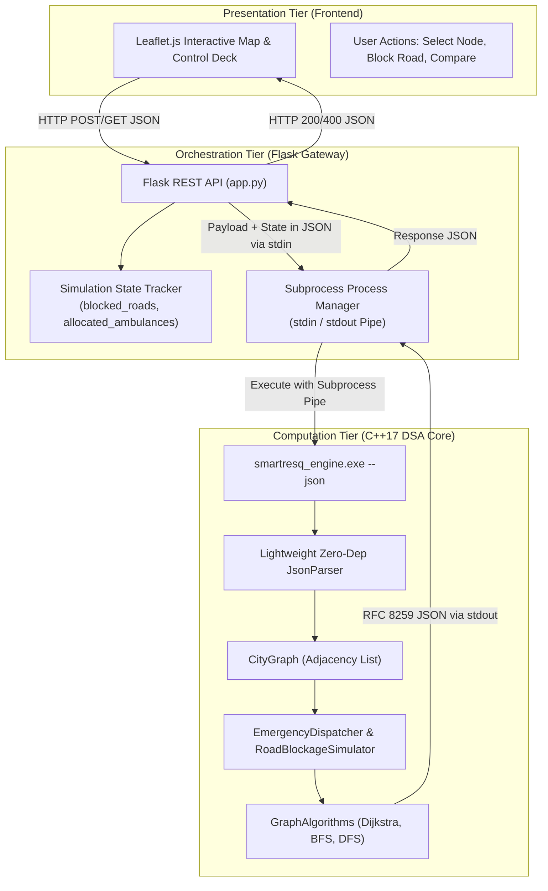
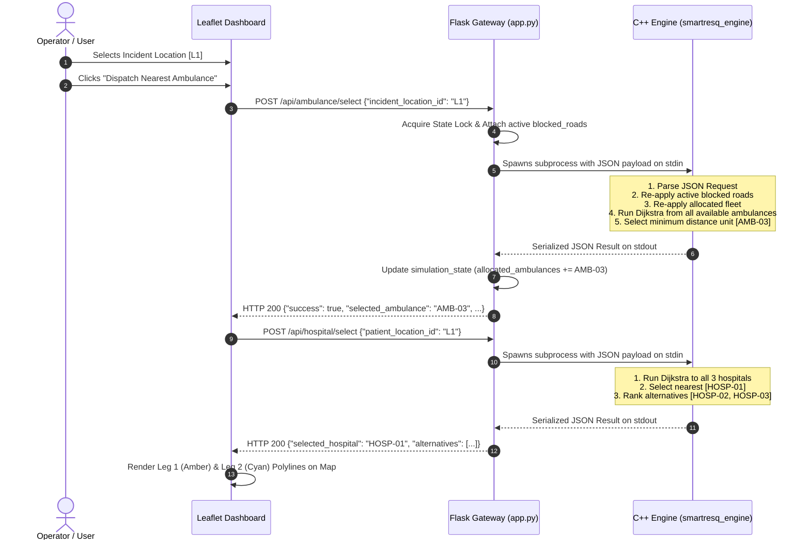

# SmartResQ – System Architecture Specification

> **Project:** SmartResQ – Emergency Ambulance Routing and Shortest Path Optimization  
> **Module:** System Architecture & Inter-Process Communication (IPC)  
> **Protocol:** JSON over Subprocess Pipes (IPC) & HTTP REST  

---

## 1. High-Level Architectural Model

SmartResQ follows a decoupled three-tier architectural pattern designed to combine native execution speed with web-based interactivity:



---

## 2. Decoupled Multi-Tier Subsystems

### 2.1 Presentation Tier (Client Dashboard)
- **Host:** Modern web browser (Chrome, Edge, Firefox).
- **Core Technologies:** HTML5, CSS3, Vanilla JavaScript (ES6+), Leaflet.js 1.9.4.
- **Responsibilities:**
  - Render CartoDB dark matter tiles and geographical node coordinates.
  - Draw city road polylines with interactive blockage tooltips.
  - Capture user selections (emergency locations, road blockage toggles, algorithm comparison triggers).
  - Issue asynchronous `fetch()` calls to the backend API.
  - Dynamically animate and overlay route waypoints, detours, and comparison statistics.

### 2.2 Orchestration Tier (Flask Gateway)
- **Host:** Python 3.10+ runtime with `Flask` and `flask-cors`.
- **Responsibilities:**
  - Expose 10 clean, standardized REST endpoints.
  - Validate client request payloads (ensuring required IDs are non-empty and well-formed).
  - Maintain session simulation state across stateless subprocess invocations:
    - Active road blockages (`simulation_state["blocked_roads"]`).
    - Allocated ambulance units (`simulation_state["allocated_ambulances"]`).
  - Thread-safe state synchronization using `threading.Lock`.
  - Invoke `smartresq_engine.exe --json` via `subprocess.run(..., input=json_str, capture_output=True)`.

### 2.3 Computation Tier (C++17 Engine)
- **Host:** Compiled native binary (`smartresq_engine.exe`).
- **Dependencies:** C++17 standard library only (`<vector>`, `<unordered_map>`, `<queue>`, `<cmath>`, etc.). Zero external package dependencies.
- **Responsibilities:**
  - Fast, memory-safe JSON parsing via [`JsonUtils.hpp`](file:///E:/DSA_Project/SmartResQ/cpp_engine/include/JsonUtils.hpp).
  - Dynamic graph reconstruction and edge blockage flags.
  - Dijkstra shortest path solver using `std::priority_queue` with Min-Heap comparator.
  - Breadth-First Search (BFS) route solver using `std::queue`.
  - Depth-First Search (DFS) component traversal using recursion.
  - Multi-candidate distance minimization for ambulance and hospital selection.
  - Emitting compact, valid RFC 8259 JSON strings to standard output.

---

## 3. Inter-Process Communication (IPC) Protocol

Communication between Python Flask and the native C++ engine uses standard input/output pipes with strict JSON payloads.

### 3.1 Sequence Diagram: Emergency Dispatch Transaction



---

## 4. End-to-End Simulation State Coordination

Because `subprocess.run` spawns an isolated operating system process for each computation, the C++ binary executes statelessly. To preserve road closures and prevent double-dispatches across multiple user interactions, Flask acts as the persistent coordinator:

```
                  +----------------------------------+
                  |  Flask Memory: simulation_state  |
                  |  - blocked_roads: {"R01"}        |
                  |  - allocated_ambs: {"AMB-03"}    |
                  +----------------------------------+
                                   |
                  Inject state into outgoing JSON payload
                                   |
                                   v
+-----------------------------------------------------------------------+
|  Request JSON to C++:                                                 |
|  {                                                                    |
|    "action": "route",                                                 |
|    "origin": "L1",                                                    |
|    "destination": "L2",                                               |
|    "blocked_roads": ["R01"],                                          |
|    "allocated_ambulances": ["AMB-03"]                                 |
|  }                                                                    |
+-----------------------------------------------------------------------+
                                   |
                                   v
+-----------------------------------------------------------------------+
|  C++ Engine Execution:                                                |
|  1. graph.reopenAllRoads();                                           |
|  2. dispatcher.resetFleetAvailability();                              |
|  3. for (r : blocked_roads) graph.blockRoad(r);                       |
|  4. for (a : allocated_ambs) dispatcher.setAvailability(a, false);   |
|  5. Compute Dijkstra shortest path excluding blocked edges!           |
+-----------------------------------------------------------------------+
```

This design eliminates race conditions, avoids shared-memory file thrashing, and guarantees that every computation runs in a clean, reproducible C++ memory space.

---

## 5. Security & Boundary Controls

1. **Input Sanitization:** All vertex and road IDs are strictly validated. If a client submits a non-existent ID (e.g. `INVALID_NODE`), the C++ engine immediately intercepts it and returns a structured 400 error without segmentation faults:
   ```json
   { "status": "error", "error": "Destination location ID 'INVALID_NODE' not found in graph.", "code": 400 }
   ```
2. **Infinite Weight Protection:** When a destination is unreachable due to road closures, C++ serializes `distance_km = -1.0` (avoiding non-standard `inf` tokens) and returns `found: false`.
3. **Execution Timeout:** All C++ subprocess calls in Python enforce a strict 10-second threshold (`timeout=10`), guarding against CPU hangs or infinite loops.

