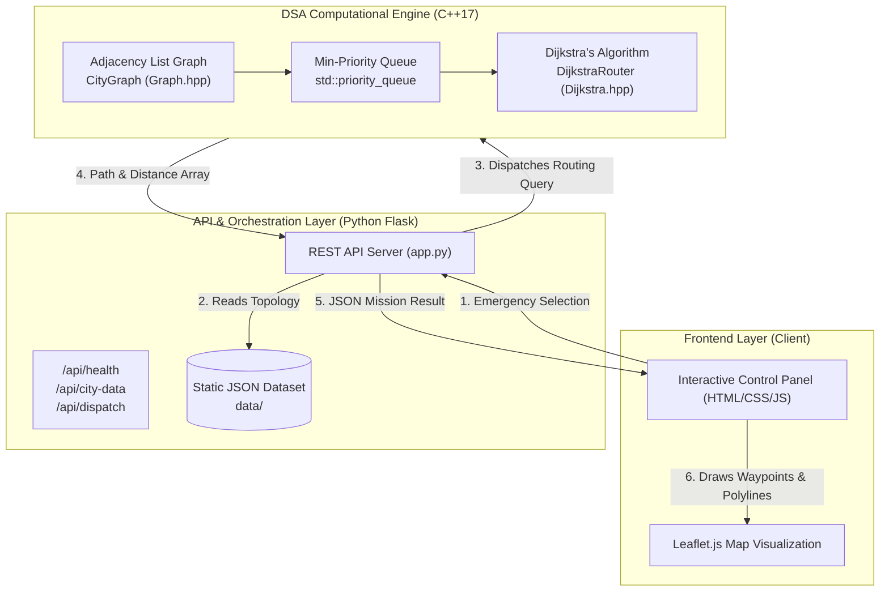

# SmartResQ – Architecture & System Design Document

**Project:** SmartResQ – Emergency Ambulance Routing and Shortest Path Optimization Using Graph Algorithms  
**Academic Level:** Third-Year Computer Engineering (Data Structures & Algorithms Mini-Project)  
**Author:** Senior Software Architect & Lead Developer  
**Status:** Phase 1 Architecture & Foundation  

---

## 1. System Overview

**SmartResQ** is an educational simulation system that applies classical graph theory and shortest-path data structures to emergency vehicle dispatch and patient transfer. 

When an emergency occurs at any node in a city network, the system solves two optimization subproblems in real-time:
1. **Pickup Leg:** Find the nearest available ambulance and calculate the shortest route from the ambulance station to the emergency incident location.
2. **Transfer Leg:** Identify the nearest equipped hospital and calculate the shortest route from the emergency incident to that hospital.



---

## 2. Architectural Layers

### 2.1 Core DSA Engine (C++17)
- **Responsibility:** High-performance graph modeling, vertex/edge management, and shortest path computation.
- **Why C++17?** Provides direct memory management, type safety, zero-cost abstractions, and standard library data structures (`std::priority_queue`, `std::unordered_map`, `std::vector`).
- **Build System:** CMake $\ge 3.16$ with modern targets (`smartresq_core`, `smartresq_engine`, `smartresq_tests`).

### 2.2 Orchestration Backend (Python Flask)
- **Responsibility:** Serves static datasets, coordinates simulation requests, exposes REST API endpoints, and bridges frontend requests to the computational core.
- **Why Flask?** Lightweight microframework with zero configuration overhead, built-in development server, and simple JSON serialization.

### 2.3 Interactive Frontend (HTML5 / Vanilla JavaScript / Leaflet.js)
- **Responsibility:** Visualizes the city map, nodes, road segments, ambulances, and hospital facilities.
- **Why Leaflet.js?** Lightweight open-source mapping library requiring no API keys, enabling offline or lightweight tile rendering and clean vector polyline overlays.

### 2.4 Data Layer (JSON)
- **Responsibility:** Single source of truth for city graph topology, ambulance locations, and hospital metadata.
- **No SQL Database:** In compliance with constraints, data is stored in deterministic JSON files (`city_graph.json`, `ambulances.json`, `hospitals.json`).

---

## 3. Data Structures & Algorithms (DSA) In-Depth

### 3.1 Graph Representation: Adjacency List
A road network is modeled as a weighted graph $G = (V, E, W)$, where:
- $V$: Set of vertices representing junctions, hospitals, and stations.
- $E$: Set of edges representing physical road segments.
- $W: E \rightarrow \mathbb{R}^+$: Edge weight representing road distance in kilometers.

#### Data Structure Choice:
- **Selected:** Adjacency List (`std::unordered_map<std::string, std::vector<RoadEdge>>`) with vertex lookups (`std::unordered_map<std::string, LocationNode>`).
- **Space Complexity:** $\mathcal{O}(|V| + |E|)$
- **Comparison with Adjacency Matrix:** An adjacency matrix would consume $\mathcal{O}(|V|^2)$ memory and require scanning all $|V|$ elements per node even though metropolitan road graphs are sparse (average vertex degree $\approx 2$ to $4$). The Adjacency List ensures optimal neighbor iteration.

#### Complexity of Graph Operations:

| Graph Operation | Method Signature | Time Complexity | Space Complexity | Description |
|---|---|---|---|---|
| **Add Vertex** | `addLocation(node)` | $\mathcal{O}(1)$ avg | $\mathcal{O}(1)$ | Hash table insertion with duplicate checking |
| **Lookup Vertex** | `hasLocation(id)`, `getLocation(id)` | $\mathcal{O}(1)$ avg | $\mathcal{O}(1)$ | Hash table key lookup |
| **Add Edge** | `addRoad(road_id, u, v, dist, bidir)` | $\mathcal{O}(\text{deg}(u) + \text{deg}(v))$ | $\mathcal{O}(1)$ amortized | Endpoint validation, duplicate prevention, and adjacency vector append |
| **Get Neighbors** | `getAdjacentLocations(u, include_blocked)` | $\mathcal{O}(\text{deg}(u))$ | $\mathcal{O}(\text{deg}(u))$ | Traverses neighbor array, optional blockage filtering |
| **Get Outgoing Roads** | `getOutgoingRoads(u, include_blocked)` | $\mathcal{O}(\text{deg}(u))$ | $\mathcal{O}(\text{deg}(u))$ | Filters active or all outgoing `RoadEdge` structs |
| **Block by Road ID** | `blockRoad(road_id)` | $\mathcal{O}(\|E\|)$ | $\mathcal{O}(1)$ | Iterates adjacency list to set `is_blocked = true` in both directions |
| **Block by Endpoints** | `blockRoad(u, v)` | $\mathcal{O}(\text{deg}(u) + \text{deg}(v))$ | $\mathcal{O}(1)$ | Finds specific connecting edge and flags it blocked |
| **Reopen by Road ID** | `reopenRoad(road_id)` | $\mathcal{O}(\|E\|)$ | $\mathcal{O}(1)$ | Resets `is_blocked = false` across both directions |
| **Reopen by Endpoints**| `reopenRoad(u, v)` | $\mathcal{O}(\text{deg}(u) + \text{deg}(v))$ | $\mathcal{O}(1)$ | Restores traffic between specific endpoints |
| **Query Blockage** | `isRoadBlocked(road_id)` / `isRoadBlocked(u, v)` | $\mathcal{O}(\|E\|)$ / $\mathcal{O}(\text{deg}(u))$ | $\mathcal{O}(1)$ | Reads edge state flag |
| **Path Reachability** | `hasPath(u, v, respect_blockage)` | $\mathcal{O}(\|V\| + \|E\|)$ | $\mathcal{O}(\|V\|)$ | Breadth-First Search (BFS) reachability check |
| **Global Connectivity**| `isConnected(respect_blockage)` | $\mathcal{O}(\|V\| + \|E\|)$ | $\mathcal{O}(\|V\|)$ | BFS traversal checking if visited count equals $\|V\|$ |
| **Display Graph** | `displayGraph(os)` | $\mathcal{O}(\|V\| + \|E\|)$ | $\mathcal{O}(1)$ | Formatted stream output of vertices and edge lists |
| **Load JSON Dataset** | `loadFromJsonFile(filepath)` | $\mathcal{O}(\|V\| + \|E\|)$ | $\mathcal{O}(\|V\| + \|E\|)$ | Zero-dependency streaming lexical scan and graph population |

### 3.2 Shortest Path: Dijkstra's Algorithm with Min-Heap
To find the minimum-distance route from an origin vertex $s \in V$ to target $t \in V$:
1. A distance table `distances[v]` is initialized to $\infty$ for all $v \in V$, with `distances[s] = 0`.
2. A predecessor table `parent[v]` records the optimal incoming edge to enable path reconstruction.
3. A Min-Heap (`std::priority_queue<std::pair<double, std::string>, ...>`) maintains vertices ordered by their tentative distance.
4. Vertices are extracted in non-decreasing order of distance. For each neighbor $v$ of current vertex $u$:
   $$\text{if } \text{distances}[u] + w(u, v) < \text{distances}[v] \implies \text{relax}(u, v)$$
5. **Early Termination:** If $u = t$, Dijkstra terminates immediately, guaranteeing optimality while minimizing unnecessary edge relaxations.
6. **Path Backtracking:** Reconstructs the complete vertex and road ID trajectory from destination back to source.

#### Computational Complexity:
- **Time Complexity:** $\mathcal{O}((|V| + |E|) \log |V|)$
- **Space Complexity:** $\mathcal{O}(|V|)$

---

### 3.3 Breadth-First Search (BFS): Minimum Road Segments (Hop-Minimal)
While Dijkstra optimizes for continuous physical distance (kilometers), Breadth-First Search (BFS) finds the route with the minimum number of road segments (turns/intersections):
1. Uses a FIFO `std::queue<std::string>` and a `visited` set.
2. Traverses the graph level by level. Because each road segment represents a single hop, the first time the target node $t$ is discovered, the path from $s$ to $t$ is guaranteed to have the minimum number of edges.
3. Reconstructs the complete route and calculates the cumulative road distance along that hop-minimal trajectory.

#### Computational Complexity:
- **Time Complexity:** $\mathcal{O}(|V| + |E|)$
- **Space Complexity:** $\mathcal{O}(|V|)$

---

### 3.4 Depth-First Search (DFS): Full Reachability Traversal
Explores the graph by visiting nodes as deep as possible along each branch before backtracking:
1. Implemented recursively with a `visited` set to track explored vertices.
2. Generates the exact sequence of vertex visits (traversal order).
3. Used for verifying component reachability, discovering isolated regions, and diagnosing traffic network disconnects.

#### Computational Complexity:
- **Time Complexity:** $\mathcal{O}(|V| + |E|)$
- **Space Complexity:** $\mathcal{O}(|V|)$

---

### 3.5 Algorithmic Comparison: Dijkstra vs. BFS vs. DFS

| Metric / Characteristic | Dijkstra's Algorithm | Breadth-First Search (BFS) | Depth-First Search (DFS) |
|---|---|---|---|
| **Primary Objective** | Minimum physical distance (km) | Minimum road segments (hops) | Complete graph reachability |
| **Edge Weights** | Non-negative edge weights ($w > 0$) | Unweighted ($w = 1$ per hop) | Unweighted / Topological |
| **Core Data Structure** | Min-Heap Priority Queue | FIFO Queue (`std::queue`) | Call Stack / System Stack |
| **Time Complexity** | $\mathcal{O}((\|V\| + \|E\|) \log \|V\|)$ | $\mathcal{O}(\|V\| + \|E\|)$ | $\mathcal{O}(\|V\| + \|E\|)$ |
| **Space Complexity** | $\mathcal{O}(\|V\|)$ | $\mathcal{O}(\|V\|)$ | $\mathcal{O}(\|V\|)$ |
| **Emergency Use Case** | Fastest ambulance dispatch route | Minimum-turn emergency transfer | City network health audit |

---

### 3.6 Ambulance and Hospital Selection Optimization

#### 3.6.1 Ambulance Selection & Double-Allocation Prevention
1. **Candidate Filtering:** Queries all registered ambulances $a \in \mathcal{A}$. Skips units where `is_available == false` or whose base location is disconnected.
2. **Dijkstra Calculation:** For each available unit, calculates $\text{dist}(a.\text{location}, \text{incident})$ using Dijkstra's algorithm.
3. **Selection Rule:**
   $$a^* = \arg\min_{a \in \mathcal{A}_{\text{avail}}} \text{dist}(a.\text{location}, \text{incident})$$
4. **State Transition (Single-Dispatch Lock):**
   Immediately sets $a^*.\text{is\_available} \leftarrow \text{false}$. This guarantees that in the same simulation session, an ambulance cannot be allocated twice. Subsequent emergency triggers dynamically bypass $a^*$ and select the next closest available unit.

#### 3.6.2 Hospital Selection & Alternative Facility Ranking
1. **Reachability Evaluation:** Iterates through all registered hospitals $h \in \mathcal{H}$. Computes $\text{dist}(\text{patient}, h.\text{location})$ via Dijkstra.
2. **Primary Selection:**
   $$h^* = \arg\min_{h \in \mathcal{H}_{\text{reach}}} \text{dist}(\text{patient}, h.\text{location})$$
3. **Alternative Ranking:** All remaining reachable hospitals $\{h \in \mathcal{H}_{\text{reach}} \setminus \{h^*\}\}$ are sorted in ascending order of travel distance and returned in `alternatives`.

#### 3.6.3 Selection Algorithm Complexities

| Selection Stage | Algorithm / Operation | Time Complexity | Space Complexity |
|---|---|---|---|
| **Ambulance Selection** | Iterated Dijkstra across available fleet | $\mathcal{O}(K \cdot (\|V\| + \|E\|) \log \|V\|)$ | $\mathcal{O}(\|V\|)$ |
| **Double-Allocation Lock**| Direct boolean state update | $\mathcal{O}(1)$ | $\mathcal{O}(1)$ |
| **Hospital Selection** | Iterated Dijkstra to candidate facilities | $\mathcal{O}(H \cdot (\|V\| + \|E\|) \log \|V\|)$ | $\mathcal{O}(\|V\| + H)$ |
| **Alternative Ranking** | Comparison sort on reachable candidates | $\mathcal{O}(H \log H)$ | $\mathcal{O}(H)$ |
| **Complete Dispatch** | Two-leg emergency coordination | $\mathcal{O}((K + H) \cdot (\|V\| + \|E\|) \log \|V\|)$ | $\mathcal{O}(\|V\| + K + H)$ |

*Note: For metropolitan fleet sizes ($K \le 5$, $H \le 5$), total execution time is under $1\text{ millisecond}$.*

### 3.7 Dynamic Road Blockage Simulation & Rerouting Architecture

The road blockage simulation modifies the underlying graph topology rather than overriding display labels:

1. **Physical Edge Closure:**
   When a road is blocked (`blockRoad(road_id)` or `blockRoad(u, v)`), the corresponding `RoadEdge` structs in `adjacency_list_` have their `is_blocked` flag set to `true` in both directions.
2. **Algorithm Integration:**
   Both `GraphAlgorithms::dijkstra` and `GraphAlgorithms::bfs` inspect `edge.is_blocked`. Any blocked edge is skipped during neighbor relaxation, ensuring that all recalculated routes strictly bypass closed roads.
3. **Delta Metrics Calculation:**
   $$\Delta \text{distance} = \text{distance}_{\text{updated}} - \text{distance}_{\text{original}}$$
   $$\text{Percentage Increase} = \left(\frac{\Delta \text{distance}}{\text{distance}_{\text{original}}}\right) \times 100\%$$
   $$\Delta \text{hops} = \text{hops}_{\text{updated}} - \text{hops}_{\text{original}}$$
4. **Bridge Severing & Unreachable Handling:**
   When a bridge road is blocked and no alternate path exists, the system flags `no_alternate_route = true`, avoids infinite loops or crashes, and returns a safe alert report.
5. **Pristine State Restoration:**
   The `resetAllBlockages()` operation performs an $\mathcal{O}(|E|)$ traversal across all adjacency lists to clear all `is_blocked` flags, returning the road network to its exact baseline state.

| Simulation Operation | Method | Time Complexity | Space Complexity | Description |
|---|---|---|---|---|
| **Simulate Closure & Reroute** | `simulateBlockageAndReroute` | $\mathcal{O}((\|V\| + \|E\|) \log \|V\|)$ | $\mathcal{O}(\|V\|)$ | Evaluates baseline, closes road, recalculates detour |
| **Reopen Road** | `reopenRoad(road_id)` | $\mathcal{O}(\|E\|)$ | $\mathcal{O}(1)$ | Restores traffic on specific road ID |
| **Reset Network State** | `resetAllBlockages()` | $\mathcal{O}(\|E\|)$ | $\mathcal{O}(1)$ | Clears all blockages across entire city graph |
| **Query Blocked Roads** | `getBlockedRoads()` | $\mathcal{O}(\|E\|)$ | $\mathcal{O}(\|E\|)$ | Collects currently active blocked road IDs |

---

## 4. Component Boundaries & Project Structure

```
SmartResQ/
├── cpp_engine/              # Core C++17 DSA Engine
│   ├── CMakeLists.txt       # Build configuration for CMake
│   ├── include/
│   │   ├── Graph.hpp        # CityGraph & Node/Edge definitions
│   │   ├── GraphAlgorithms.hpp # Dijkstra, BFS, DFS algorithms
│   │   ├── EmergencyDispatcher.hpp # Simple ambulance & hospital selector
│   │   ├── RoadBlockageSimulator.hpp # Dynamic road blockage & detour analyzer
│   │   └── Dijkstra.hpp     # Shortest path wrappers
│   ├── src/
│   │   ├── Graph.cpp        # Adjacency list & JSON parser implementation
│   │   ├── GraphAlgorithms.cpp # Min-heap Dijkstra, BFS queue, DFS traversal
│   │   ├── EmergencyDispatcher.cpp # Fleet allocation & hospital alternative ranking
│   │   ├── RoadBlockageSimulator.cpp # Closure simulation & distance diff metrics
│   │   ├── Dijkstra.cpp     # Delegation bridge
│   │   └── main.cpp         # CLI simulation runner
│   └── tests/
│       └── test_graph.cpp   # Automated unit test suite (20 test cases)
├── backend/
│   └── app.py               # Flask REST API service
├── frontend/
│   ├── index.html           # Single-page simulation dashboard
│   ├── css/
│   │   └── style.css        # Responsive styling & dark theme
│   └── js/
│       └── app.js           # Leaflet map controller & API client
├── data/
│   ├── city_graph.json      # 18 locations, 29 road connections
│   ├── ambulances.json      # 3 deployed ambulance units
│   └── hospitals.json       # 3 trauma/general hospitals
├── docs/
│   ├── architecture.md      # System architecture specification
│   └── api_spec.md          # REST API communication contract
└── README.md                # Project documentation & run guide
```

---

## 5. Architectural Constraints & Design Principles

| Constraint | Architectural Decision | Rationale |
|---|---|---|
| **No SQL Database** | Static JSON files in `data/` | Eliminates database setup; dataset is static and easily editable. |
| **No Authentication** | Open REST endpoints | Educational simulation intended for direct local demonstration. |
| **No External Traffic API** | Deterministic edge weights in `city_graph.json` | Fully offline, reproducible test cases without API keys or rate limits. |
| **No Real-Time GPS** | Discrete topological nodes | Focuses strictly on core DSA algorithms rather than hardware drivers. |
| **Pure C++ DSA Core** | Core logic isolated in `cpp_engine/` | Fulfills academic computer engineering objective of native DSA implementation. |

---

## 6. Verification & Quality Assurance Strategy

1. **Unit Testing:** `smartresq_tests` rigorously asserts graph invariants, triangle inequality shortest path selection, and multi-candidate selection.
2. **Backend Health Check:** Automated check verifies JSON file readability and endpoint availability on startup.
3. **Frontend Diagnostics:** Real-time visual status pill indicates backend connectivity and data integrity.

